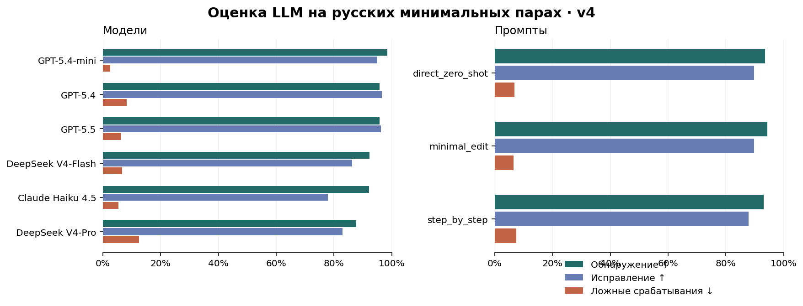

# Russian LLM Minimal Pairs

**Русский** · [English summary](docs/english.md)

Эксперимент из ВКР «Определение нарушений правил русского языка большими языковыми моделями». Шесть моделей OpenAI, DeepSeek и Anthropic проверялись на грамматических, орфографических и пунктуационных минимальных парах. Изменение в паре контролируется, поэтому можно отдельно измерить пропуски ошибок и ложные срабатывания на правильных предложениях.

В финальной версии **80 пар, 160 предложений и 2 880 ответов моделей**. Всего по четырём версиям сохранено **5 832 результата**.



## Итоги эксперимента

| Версия | Пар | Ответов | Обнаружение | Исправление | Ложные срабатывания |
| --- | ---: | ---: | ---: | ---: | ---: |
| v1 | 8 | 288 | 91,67% | 81,25% | 16,67% |
| v2 | 26 | 936 | 91,13% | 86,11% | 10,90% |
| v3 | 48 | 1 728 | 93,63% | 89,58% | 7,52% |
| v4 | 80 | 2 880 | 93,72% | 89,17% | 6,94% |

### Шесть моделей на v4

| Модель | Ответов | Обнаружение | Исправление | Ложные срабатывания |
| --- | ---: | ---: | ---: | ---: |
| GPT-5.4-mini | 480 | **98,54%** | 95,00% | **2,50%** |
| GPT-5.4 | 480 | 95,83% | **96,67%** | 8,33% |
| GPT-5.5 | 480 | 95,83% | 96,25% | 6,25% |
| DeepSeek V4-Flash | 480 | 92,29% | 86,25% | 6,67% |
| DeepSeek V4-Pro | 480 | 87,71% | 82,92% | 12,50% |
| Claude Haiku 4.5 | 480 | 92,08% | 77,92% | 5,42% |

### Три промпта на v4

| Промпт | Ответов | Обнаружение | Исправление | Ложные срабатывания |
| --- | ---: | ---: | ---: | ---: |
| `direct_zero_shot` | 960 | 93,65% | **89,79%** | 6,88% |
| `minimal_edit` | 960 | **94,38%** | **89,79%** | **6,46%** |
| `step_by_step` | 960 | 93,13% | 87,92% | 7,50% |

GPT-5.4-mini лучше всего обнаруживала ошибки и реже помечала правильные предложения как ошибочные. GPT-5.4 показала максимальную точность исправления. `minimal_edit` лидировал по обнаружению и доле ложных срабатываний. По исправлению он разделил первое место с `direct_zero_shot`.

[Все срезы по версиям, моделям, правилам, промптам и сложности](reports/metrics_full_tables/) · [Модель × промпт × версия](reports/stability/model_prompt_trends.csv) · [Независимый аудит](reports/metrics_audit_final/)

## Данные и воспроизводимость

- [Корпус v1–v4](final/) содержит пары и отдельные предложения в CSV и JSON. У ошибочного предложения есть эталонное исправление.
- [Запуски](runs/) содержат нормализованные предсказания, ошибки обнаружения и таблицы метрик каждой версии. CSV с предсказаниями сжаты gzip. Служебные поля `raw_text` и `raw_json` удалены из выгрузки.
- [Методика](docs/methodology.md) описывает постановку задачи, знаменатели метрик и ограничения сравнения.
- [Исходники](main.py) охватывают генерацию, ручную проверку, API-запуски и расчёт метрик. [Полная инструкция](docs/generator-api.md) описывает команды, [конфиги](configs/) фиксируют матрицы запусков.

Запускайте команды из корня репозитория. Пересчёт результатов выполняется локально на Python 3.10+ без внешних зависимостей.

```bash
python main.py --api-mode metrics --input runs/main_experiment_v4/normalized_results.csv.gz --output-dir scratch/recomputed-v4
python -m unittest discover -s tests -v
```

Первая команда создаёт семь таблиц. Их можно сверить с [метриками исходного запуска](runs/main_experiment_v4/metrics/). Для проверки другой версии замените `v4` в двух путях. Команды для генерации корпуса, пробного запуска и обращения к API есть в [инструкции](docs/generator-api.md).
